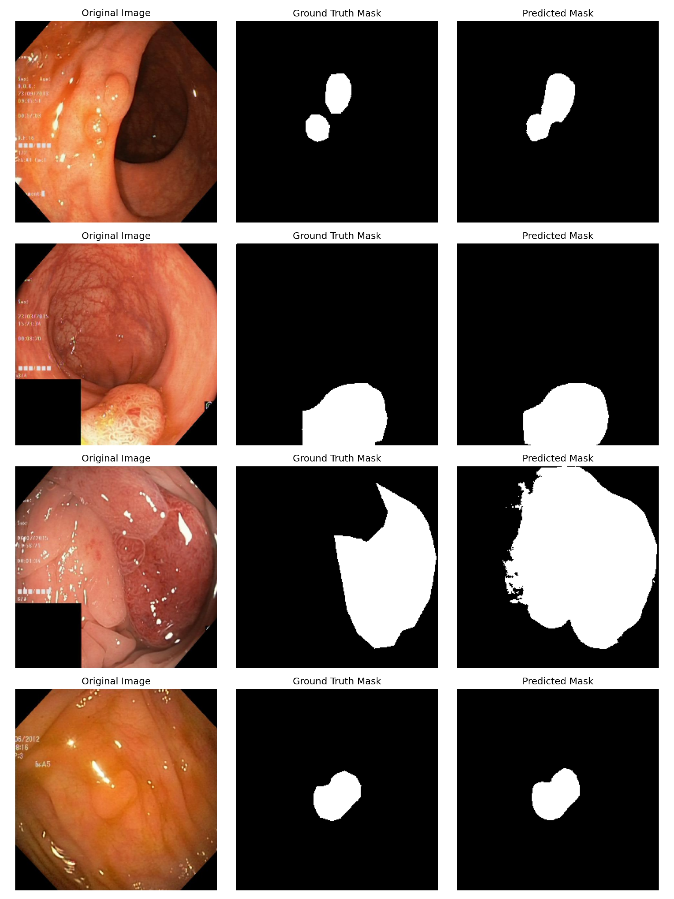

# Сегментация полипов — U-Net + ResNet34

Бинарная сегментация полипов на колоноскопических снимках. Архитектура — U-Net с энкодером ResNet34, предобученным на ImageNet. Трекинг экспериментов — MLflow.



---

## Результаты

| Метрика       | Значение   |
|---------------|------------|
| Best Val Dice | **0.9026** |
| Best Val Loss | **0.0942** |
| Эпох          | 30         |

---

## Датасет

[Kvasir-SEG](https://www.kaggle.com/datasets/abdallahwagih/kvasir-dataset-for-classification-and-segmentation) — 1000 колоноскопических снимков с попиксельными масками полипов, размеченными врачами.

| Выборка    | Снимков |
|------------|---------|
| Обучение   | 800     |
| Валидация  | 200     |

---

## Архитектура

Модель построена по схеме **Энкодер–Декодер** со skip connections (U-Net).

```
Входное изображение  [3 × 256 × 256]
        │
        ▼
┌─────────────────────────────────────────────────────────┐
│                  ЭНКОДЕР  (ResNet34)                    │
│               предобучен на ImageNet                    │
│                                                         │
│  stem ──► block1 ──► block2 ──► block3 ──► block4      │
│ 256×256   128×128    64×64      32×32      16×16        │
│  64ch      64ch      128ch      256ch      512ch        │
└───┬─────────┬──────────┬──────────┬──────────┬─────────┘
    │ skip1   │ skip2    │ skip3    │ skip4    │ bottleneck
    │         │          │          │          │
┌───▼─────────▼──────────▼──────────▼──────────▼─────────┐
│                  ДЕКОДЕР  (U-Net)                       │
│                                                         │
│  up1  ◄──  up2  ◄──  up3  ◄──  up4  ◄──  bottleneck   │
│ 256×256   128×128    64×64      32×32      16×16        │
└─────────────────────────────────────────────────────────┘
        │
        ▼
Выходная маска  [1 × 256 × 256]   (sigmoid → порог 0.5)
```

**Ключевые решения:**

- **Transfer Learning** — веса энкодера берутся из предобучения на ImageNet. Это позволяет переиспользовать детекторы низкоуровневых признаков (края, текстуры) и получить высокий Dice при всего ~800 медицинских снимках.
- **Skip connections** — карты признаков каждого уровня энкодера конкатенируются с соответствующим уровнем декодера. Это сохраняет мелкие пространственные детали (границы полипов), которые теряются при даунсэмплинге.
- **Один выходной канал + sigmoid** — бинарная сегментация: каждый пиксель получает вероятность принадлежности к полипу. На инференсе порог 0.5.

---

## Функция потерь и метрика

| | |
|---|---|
| **Loss** | `BCEWithLogitsLoss` — бинарная кросс-энтропия со встроенной sigmoid (численно устойчива) |
| **Метрика** | **Dice coefficient** = 2·\|Pred ∩ GT\| / (\|Pred\| + \|GT\|) |

Accuracy не подходит из-за дисбаланса классов: полип занимает малую долю пикселей, поэтому предсказание «всё фон» даёт высокую accuracy. Dice напрямую измеряет перекрытие масок и устойчив к дисбалансу.

---

## Параметры обучения

| Параметр      | Значение            |
|---------------|---------------------|
| Размер фото   | 256 × 256           |
| Batch size    | 8                   |
| Эпох          | 30                  |
| Оптимизатор   | Adam                |
| Learning rate | 1e-4                |
| Val split     | 20%                 |
| Чекпоинт      | эпоха с лучшим val Dice |

**Аугментации на обучении** (Albumentations):

| Трансформация        | Вероятность |
|----------------------|-------------|
| Horizontal Flip      | 0.5         |
| Vertical Flip        | 0.5         |
| Random Rotate 90°    | 0.5         |
| Normalize (ImageNet) | всегда      |

На валидации — только resize + normalize, без случайных трансформаций.

Чекпоинт сохраняется только при улучшении `val_dice` — в итоге сохраняется не последняя эпоха, а лучшая.

---

## Трекинг экспериментов (MLflow)

Каждый запуск логируется в MLflow:

- **Параметры**: image size, batch size, epochs, learning rate, энкодер, архитектура
- **Метрики по эпохам**: `train_loss`, `train_dice`, `val_loss`, `val_dice`
- **Артефакты**: `best_model.pth`, полная модель через `mlflow.pytorch.log_model`

---

## Структура проекта

```
polyp_segmentation/
├── config.py      — гиперпараметры и пути к данным
├── dataset.py     — Dataset, аугментации, фабрика DataLoader
├── model.py       — сборка U-Net (segmentation-models-pytorch)
├── train.py       — цикл обучения с MLflow-логированием
├── evaluate.py    — инференс и визуализация предсказаний
└── results.png    — примеры (оригинал / разметка / предсказание)
```

---

## Запуск

**Установка зависимостей:**
```bash
pip install torch torchvision opencv-python albumentations scikit-learn \
            segmentation-models-pytorch matplotlib tqdm mlflow
```

**Путь к датасету** (по умолчанию `~/Downloads/archive/kvasir-seg/Kvasir-SEG`):
```bash
export DATA_DIR=/path/to/Kvasir-SEG
```

**Обучение:**
```bash
python train.py
```

**MLflow UI** после обучения:
```bash
mlflow ui
# → http://localhost:5000
```

**Визуализация предсказаний:**
```bash
python evaluate.py   # сохраняет results.png
```
